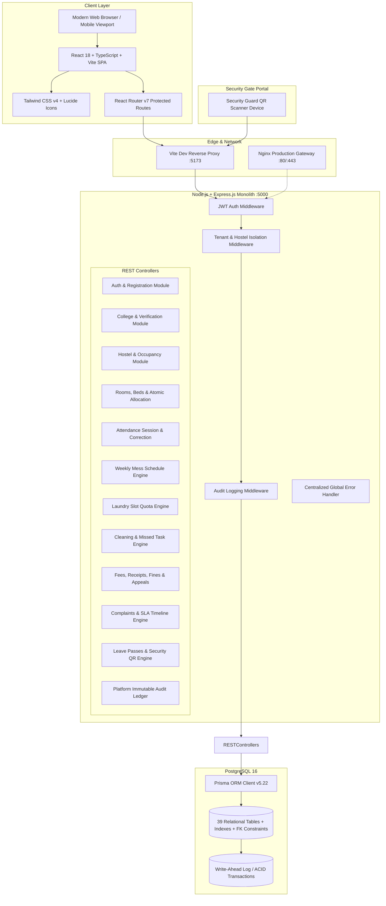
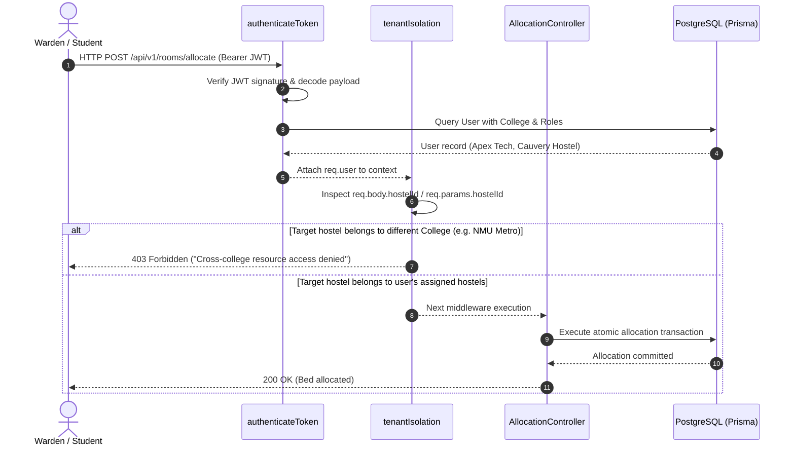
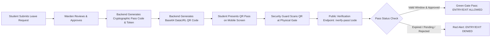

# HostelHub — Architectural Specification & System Design

**Project**: HostelHub — Smart Multi-College Hostel Management System  
**Version**: 1.0.0 Production Architecture  
**Engineering Team**: B.Tech Final Year Capstone Project (4-Developer Team)  
**System Classification**: Multi-Tenant Enterprise Educational SaaS  

---

## 1. High-Level System Topology

HostelHub is structured as a **modular, monolithic backend architecture** paired with an **optimistic, responsive Single Page Application (SPA)**. This topology delivers enterprise-grade operational stability and zero microservice overhead, allowing a 4-person development team to maintain, test, and evolve the platform without distributed transaction failures.



---

## 2. Multi-College Tenant Isolation & Security Boundary

Data isolation is the critical architectural invariant in HostelHub. Multiple universities share a single database, but **no tenant may ever query, mutate, or view another university's student or hostel data**.

### Isolation Guarantees

| User Persona | Scoping Boundary | Enforcement Mechanism |
| :--- | :--- | :--- |
| **Platform Admin** | Platform-wide verification & audit | Can review College pending status, suspend colleges, and inspect platform metrics. **Zero access to private student medical/room details without audit.** |
| **Hostel Warden** | Strictly bound to `collegeId` + assigned `hostelId`s | `tenantIsolation` middleware verifies that the target hostel exists in `req.user.wardenAssignments`. Cross-college requests immediately terminate with `403 Forbidden`. |
| **Student Resident** | Strictly bound to own `studentProfileId` + assigned room | Can only access their own room, fees, fine appeals, leaves, and attendance. Cross-student queries return `403 Forbidden`. |
| **Public Visitor** | Public colleges directory + Gate Pass Token | Can only view colleges with `status: APPROVED`. Gate pass endpoint queries only non-PII pass status and validity timestamps. |

### Tenant Middleware Enforcement Sequence



---

## 3. Concurrency Control & Atomic Transactions

HostelHub addresses classic hostel operational race conditions through **PostgreSQL ACID Transactions** managed by `prisma.$transaction`:

### A. Atomic Bed Allocation & Double-Booking Prevention
When a warden allocates a bed to an approved student:
1. Lock bed row and verify `bed.status === 'AVAILABLE'`.
2. Check if student already has an active allocation (`status: 'ACTIVE'`).
3. If valid, create `RoomAllocation` record, mark previous allocation (if any) as `TRANSFERRED`, and update `Bed.status = 'OCCUPIED'`.
4. If two wardens attempt to allocate the exact same bed concurrently, PostgreSQL row-level locks force sequential execution; the second request throws a `400 Bad Request: Bed is already occupied`.

### B. Laundry Machine Slot Quota Enforcement
1. Laundry time slots specify an immutable `capacity` (e.g., 6 washing machines per 2-hour window).
2. Within a `prisma.$transaction`, the booking controller queries active bookings where `slotId = :slotId AND status != 'CANCELLED'`.
3. If `activeBookings >= slot.capacity`, the transaction aborts with `400 Slot is fully booked`.

### C. Sequential Financial Receipt Generation
All payments recorded in HostelHub produce an unalterable, collision-free receipt number formatted as `RCP-<YEAR>-<COLLEGE_CODE>-<RANDOM_HEX>`. Both the `Payment` creation and `FeeCharge.paidAmount` increment occur inside a single atomic boundary.

---

## 4. Digital Gate Pass & QR Security Architecture

Leave approval and campus exit verification operate on a tamper-proof digital verification pipeline:



1. **Token Generation**: Upon Warden approval, the system generates a secure alphanumeric pass code (`OUT-<RANDOM6>`) and a unique 256-bit UUID token.
2. **QR Code Rendering**: The backend uses the `qrcode` library to generate a high-density PNG encoded as a Base64 data URI (`data:image/png;base64,...`), stored alongside the leave record.
3. **Public Gate Terminal**: Campus security personnel do not require full system logins. They access `/verify-pass/:code` which displays:
   - Student Full Name & Roll Number
   - Leave Type (Outstation / Day Outing / Emergency)
   - Permitted Departure and Return Datetimes
   - Live Validity Status Banner (Active, Expired, Revoked)

---

## 5. Security & Threat Modeling

| Threat Vector | Mitigation Strategy |
| :--- | :--- |
| **SQL Injection** | Prisma ORM uses parameterized SQL queries exclusively; no raw concatenated SQL strings are permitted. |
| **Cross-Site Scripting (XSS)** | React JSX escapes interpolated strings by default; Strict Content-Security-Policy headers applied via Helmet middleware. |
| **Privilege Escalation** | `requireRoles` middleware evaluates server-side JWT claims against DB state; users cannot alter their role by modifying frontend payloads. |
| **Credential Stuffing** | Argon2id / bcrypt password hashing with automatic 12 salt rounds; IP-based rate limiting on `/api/v1/auth/login`. |
| **Tenant Data Bleed** | Centralized `tenantIsolation` middleware executes before all business controllers. Unit and integration tests verify cross-tenant 403 enforcement. |
| **Audit Log Tampering** | Audit records in `AuditLog` table are append-only; no `UPDATE` or `DELETE` endpoints exist for audit entities. |

---

## 6. Deployment Architecture

For on-premise university deployments or cloud hosting (Render, AWS, DigitalOcean):

```
                   +------------------------+
                   | Cloudflare DNS & DDoS  |
                   +-----------+------------+
                               |
                               v
                     +---------+---------+
                     |  Nginx Reverse    |
                     |  Proxy (SSL Term) |
                     +----+---------+----+
                          |         |
           +--------------+         +--------------+
           |                                       |
           v                                       v
+----------+------------+               +----------+------------+
| Frontend Static Files |               | Node.js Cluster       |
| (Vite SPA Production  |               | Express REST API      |
| Build: /dist)         |               | Port :5000            |
+-----------------------+               +----------+------------+
                                                   |
                                                   v
                                        +----------+------------+
                                        | PostgreSQL 16 DB      |
                                        | Port :5432            |
                                        +-----------------------+
```
