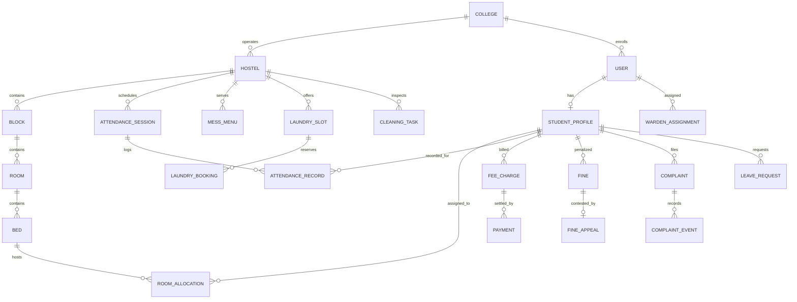

# HostelHub — Database Specification & Schema Architecture

**Database Engine**: PostgreSQL 16  
**ORM Layer**: Prisma ORM v5.22  
**Schema File**: `prisma/schema.prisma`  
**Migration Strategy**: Strict schema migrations via `npx prisma migrate`  

---

## 1. Entity Relationship Overview

The schema is divided into 7 core functional sub-domains:
1. **Identity & Multi-Tenancy**: `User`, `College`, `Hostel`, `WardenAssignment`, `StudentProfile`
2. **Infrastructure & Bed Allocation**: `Block`, `Room`, `Bed`, `RoomAllocation`
3. **Attendance & Roll Call**: `AttendanceSession`, `AttendanceRecord`
4. **Operations & Facility Services**: `MessMenu`, `LaundrySlot`, `LaundryBooking`, `CleaningTask`, `Facility`, `CafeteriaItem`
5. **Billing, Charges & Discipline**: `FeeCategory`, `FeeCharge`, `Payment`, `Fine`, `FineAppeal`
6. **Student Support & Movement**: `Complaint`, `ComplaintEvent`, `LeaveRequest`
7. **Broadcasts & Audit**: `Notice`, `Notification`, `AuditLog`, `HostelRule`

---

## 2. Core Tables & Column Specifications

### A. Identity & Tenancy Domain

#### `College`
Stores accredited educational institutions on the platform.
- `id` (UUID, PK): Unique college identifier.
- `name` (VarChar, Unique): Official institution name.
- `code` (VarChar, Unique): Short institution acronym (e.g. `AIT-TECH`).
- `officialEmail` (VarChar, Unique): Accredited domain email.
- `phone`, `website`, `address`, `city`, `state`, `pincode`: Official postal and contact attributes.
- `status` (Enum: `PENDING_VERIFICATION`, `APPROVED`, `REJECTED`, `SUSPENDED`): Platform verification status.
- `verificationReason` (Text, Nullable): Justification recorded by Platform Admin.
- `verifiedAt` (Timestamp, Nullable): Date of verification decision.
- `verifiedById` (UUID, Nullable, FK -> `User.id`): Admin who performed review.

#### `User`
Central authentication identity for all platform actors.
- `id` (UUID, PK): Unique user identifier.
- `email` (VarChar, Unique): Institutional login email address.
- `passwordHash` (VarChar): Argon2id/bcrypt salted password hash.
- `fullName` (VarChar): User's legal name.
- `phone` (VarChar, Nullable): Phone number.
- `role` (Enum: `PLATFORM_ADMIN`, `WARDEN`, `STUDENT`): Role-based access control tier.
- `collegeId` (UUID, Nullable, FK -> `College.id`): University residency anchor.
- `isActive` (Boolean, Default: true): Soft revocation toggle.

#### `StudentProfile`
Extended attributes for verified resident students.
- `id` (UUID, PK): Unique student record ID.
- `userId` (UUID, Unique, FK -> `User.id`): Associated authentication record.
- `rollNumber` (VarChar, Unique): University enrollment identifier.
- `course` (VarChar): Degree program (e.g. B.Tech Computer Science).
- `year` (Int): Current academic year (1 through 5).
- `guardianName`, `guardianPhone`: Parent/Guardian emergency contacts.
- `status` (Enum: `PENDING_APPROVAL`, `APPROVED`, `REJECTED`, `ALUMNI`): Warden verification status.

#### `WardenAssignment`
Many-to-many relationship linking a Warden to specific hostels within their college.
- `id` (UUID, PK): Assignment link ID.
- `userId` (UUID, FK -> `User.id`): Warden user account.
- `hostelId` (UUID, FK -> `Hostel.id`): Assigned hostel jurisdiction.
- `assignedAt` (Timestamp): Assignment appointment timestamp.

---

### B. Room & Bed Allocation Domain

#### `Hostel`
Physical student living facilities.
- `id` (UUID, PK): Hostel ID.
- `collegeId` (UUID, FK -> `College.id`): Governing university.
- `name` (VarChar): Residential hall title (e.g. Cauvery Boys Hostel).
- `type` (Enum: `BOYS`, `GIRLS`, `MIXED`): Gender assignment policy.
- `totalFloors` (Int): Vertical elevation levels.

#### `Room` & `Bed`
Granular physical accommodation hierarchy.
- **`Room`**:
  - `id` (UUID, PK): Room ID.
  - `blockId` (UUID, FK -> `Block.id`): Wing or architectural block.
  - `roomNumber` (VarChar): Room identifier (e.g. `101`).
  - `floor` (Int): Floor number.
  - `roomType` (Enum: `SINGLE`, `DOUBLE`, `TRIPLE`, `DORMITORY`).
  - `capacity` (Int): Maximum resident limit.
- **`Bed`**:
  - `id` (UUID, PK): Bed ID.
  - `roomId` (UUID, FK -> `Room.id`): Containing room.
  - `bedNumber` (VarChar): Specific bunk or bed slot (e.g. `101-A`, `101-B`).
  - `status` (Enum: `AVAILABLE`, `OCCUPIED`, `MAINTENANCE`, `RESERVED`).

#### `RoomAllocation`
Historical and active allocation ledger.
- `id` (UUID, PK): Allocation event ID.
- `studentId` (UUID, FK -> `StudentProfile.id`): Assigned student.
- `bedId` (UUID, FK -> `Bed.id`): Assigned bed.
- `roomId` (UUID, FK -> `Room.id`): Associated room cache.
- `hostelId` (UUID, FK -> `Hostel.id`): Associated hostel cache.
- `collegeId` (UUID, FK -> `College.id`): Associated college cache.
- `status` (Enum: `ACTIVE`, `TRANSFERRED`, `CHECKED_OUT`).
- `startDate` (Timestamp): Date resident took possession.
- `endDate` (Timestamp, Nullable): Date resident vacated.

---

### C. Financials & Disciplinary Domain

#### `FeeCategory` & `FeeCharge`
Tuition, hostel rent, mess dues, and utility charges.
- **`FeeCategory`**: `COLLEGE_HOSTEL_FEE`, `MESS_FEE`, `CAUTION_DEPOSIT`, `UTILITY_CHARGES`.
- **`FeeCharge`**:
  - `id` (UUID, PK): Charge item ID.
  - `studentId` (UUID, FK -> `StudentProfile.id`): Billed resident.
  - `amount` (Decimal): Total due amount.
  - `paidAmount` (Decimal, Default: 0): Settled amount.
  - `dueDate` (Date): Payment deadline.
  - `status` (Enum: `PENDING`, `PARTIAL`, `PAID`, `OVERDUE`).

#### `Payment`
Auditable record of settled transactions.
- `id` (UUID, PK): Payment transaction ID.
- `chargeId` (UUID, FK -> `FeeCharge.id`): Corresponding fee invoice.
- `studentId` (UUID, FK -> `StudentProfile.id`): Resident making payment.
- `amount` (Decimal): Value credited.
- `receiptNumber` (VarChar, Unique): Collision-free sequential transaction hash.
- `paymentMethod` (Enum: `ONLINE_UPI`, `NET_BANKING`, `CREDIT_CARD`, `BANK_CHALLAN`, `CASH`).
- `transactionRef` (VarChar, Nullable): Gateway reference or bank scroll number.

#### `Fine` & `FineAppeal`
Disciplinary fines for curfew breaches, property damage, or noise violations.
- **`Fine`**:
  - `id` (UUID, PK): Fine infraction ID.
  - `studentId` (UUID, FK -> `StudentProfile.id`): Cited resident.
  - `title`, `description`: Infraction description.
  - `amount` (Decimal): Financial penalty.
  - `status` (Enum: `ISSUED`, `APPEALED`, `WAIVED`, `PAID`).
- **`FineAppeal`**:
  - `fineId` (UUID, Unique, FK -> `Fine.id`): Contested citation.
  - `reason` (Text): Student's defense explanation.
  - `status` (Enum: `PENDING`, `ACCEPTED`, `REJECTED`).
  - `wardenRemarks` (Text, Nullable): Review decision rationale.

---

### D. Digital Movement & Gate Pass Domain

#### `LeaveRequest`
Permissions for outstation journeys, day outings, and emergency absences.
- `id` (UUID, PK): Leave request ID.
- `studentId` (UUID, FK -> `StudentProfile.id`): Requesting student.
- `leaveType` (Enum: `OUTSTATION`, `DAY_OUTING`, `EMERGENCY`, `NIGHT_STAY`).
- `departureDate` (Timestamp): Intended departure time.
- `returnDate` (Timestamp): Mandated arrival time.
- `destination`: Travel destination city/address.
- `reason`: Travel purpose.
- `parentConsentObtained` (Boolean): Consent verification status.
- `status` (Enum: `PENDING`, `APPROVED`, `REJECTED`, `EXPIRED`, `CANCELLED`).
- `passCode` (VarChar, Nullable, Unique): Short 8-character verification string (e.g. `OUT-98714`).
- `passToken` (VarChar, Nullable, Unique): 256-bit cryptographic verification token.
- `qrCodeDataUrl` (Text, Nullable): Encoded Base64 PNG QR code rendered for guards.
- `wardenRemarks` (Text, Nullable): Warden's operational notes.

---

## 3. Database Indexes & Performance Optimizations

To guarantee sub-15ms response times across queries, the following targeted compound indexes are enforced in PostgreSQL:

1. **Multi-Tenant College Isolation Index**:
   - `Hostel(collegeId)`: Ensures fast filtering of hostels by university.
   - `RoomAllocation(collegeId, status)`: Accelerates active student occupancy reporting.
2. **Bed Uniqueness Index**:
   - `RoomAllocation(bedId, status)`: Enforces rapid lookups to guarantee no two active allocations reference the same bed.
3. **Student Roll Number Index**:
   - `StudentProfile(rollNumber)`: Unique index prevents duplicate enrollment across colleges.
4. **Attendance Session Index**:
   - `AttendanceRecord(sessionId, studentId)`: Unique composite index prevents duplicate roll-call entries within the same roll session.
5. **Gate Pass Token Index**:
   - `LeaveRequest(passToken)` & `LeaveRequest(passCode)`: Index lookups ensure physical security gate scanning completes in under 5 milliseconds.
6. **Audit Event Chronology Index**:
   - `AuditLog(createdAt DESC)`: Accelerates reverse-chronological streaming of platform administrative events.
